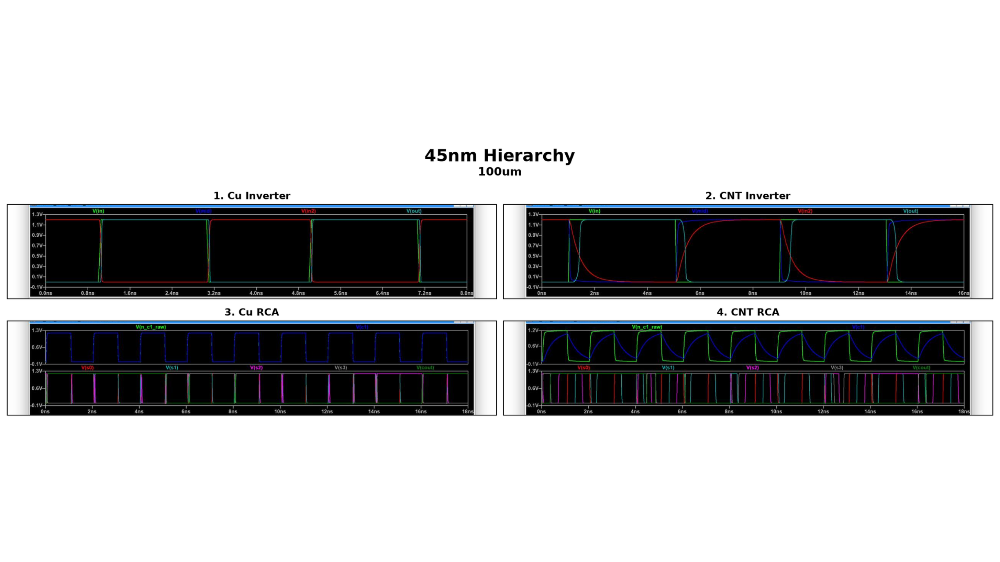
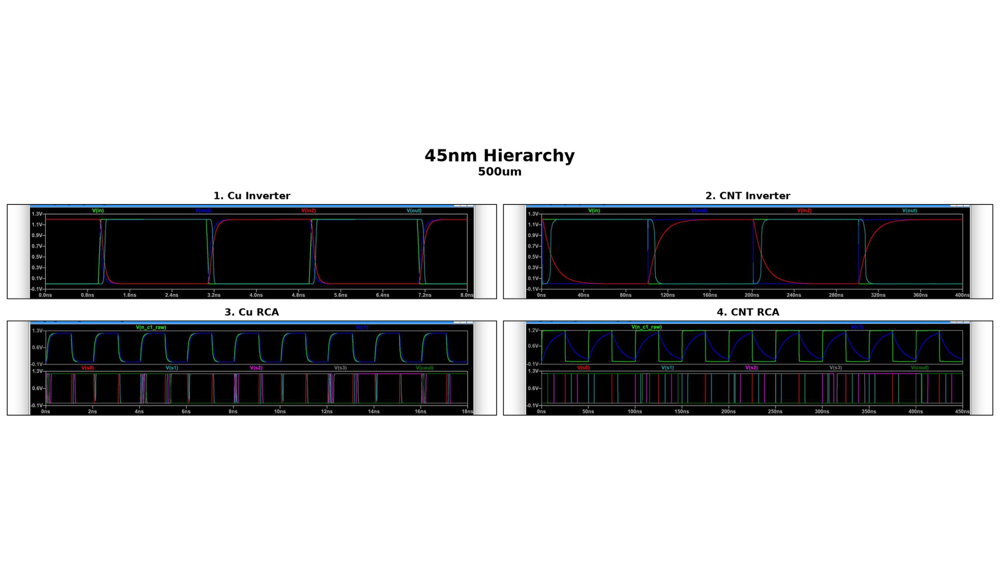
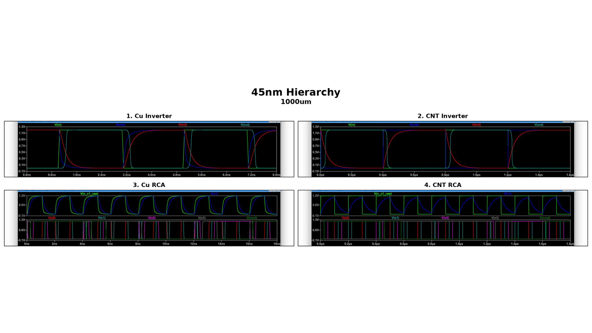
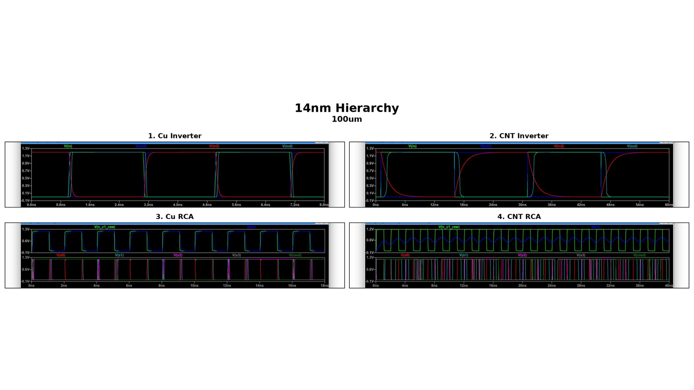
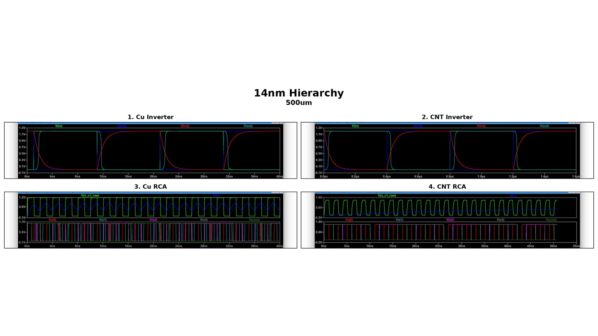
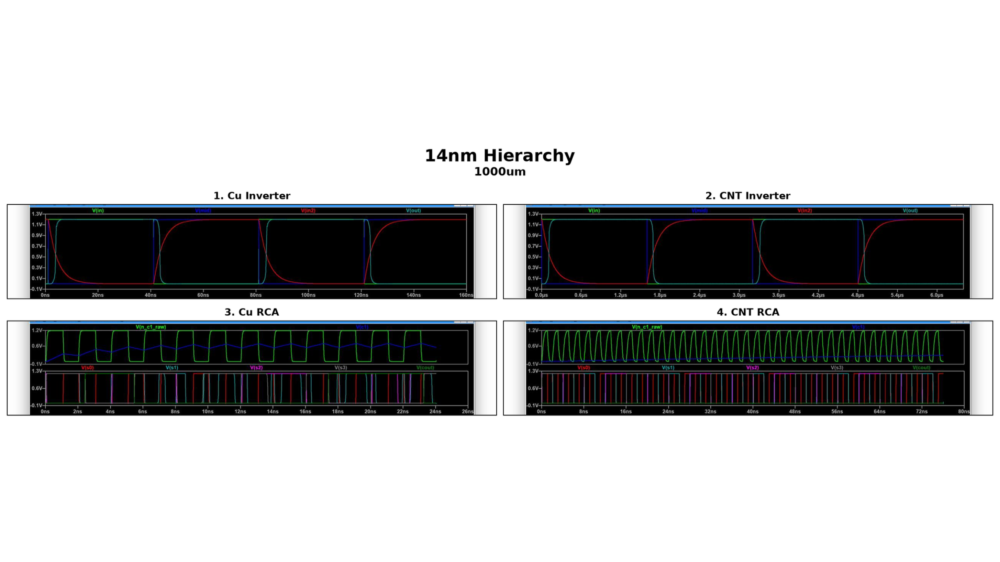
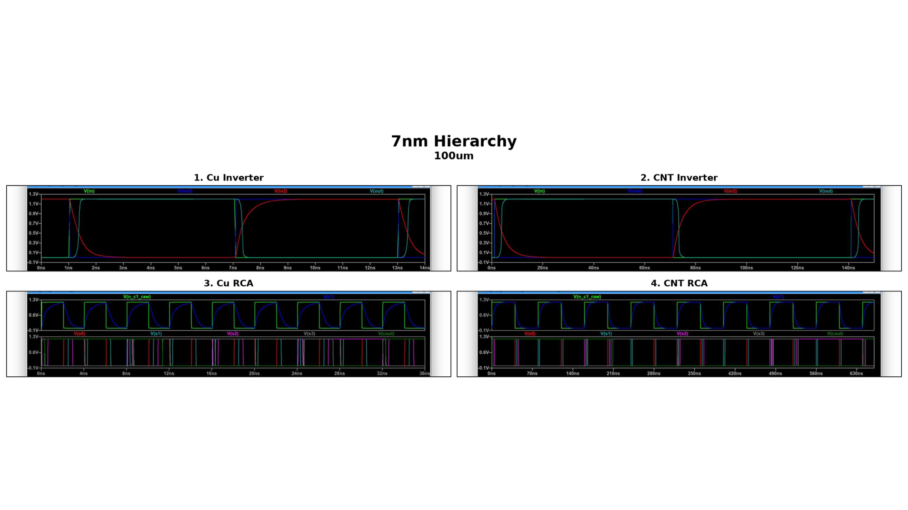
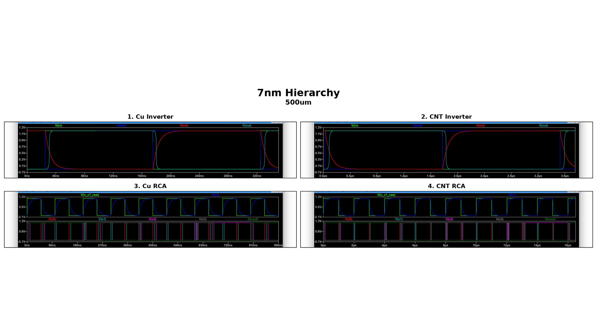
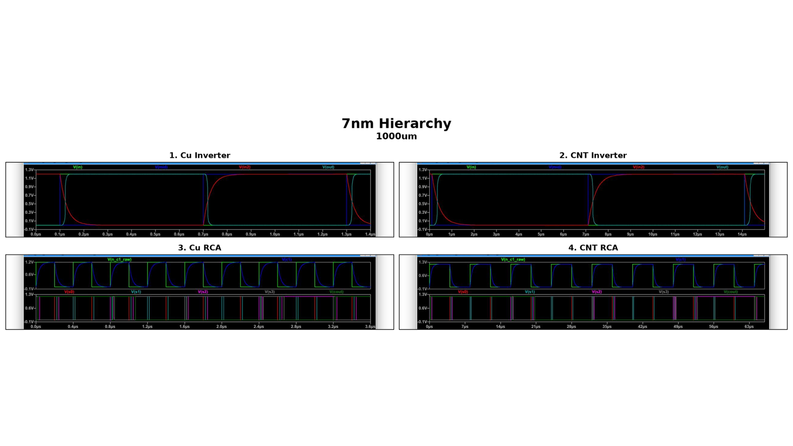

# Interconnect Comparison Study

## Overview

This repository contains the simulation models, calculation references, and waveform results prepared during the NIT internship study of copper (Cu) and single-wall carbon nanotube (SWCNT) bundle interconnects.

The study evaluates two digital structures:

- A two-stage CMOS inverter chain
- A 4-bit ripple-carry adder (RCA)

The transistor logic is modeled with generic 90 nm CMOS devices. The interconnect is represented as a lumped RLC pi-segment and is varied by material, technology node, and wire length. This keeps the logic topology consistent while making the effect of the interconnect easier to compare.

## Primary Documents

| Document | Description |
| --- | --- |
| [Internship report](intern_nit_report.pdf) | Detailed methodology, calculations, simulation setup, analysis, and conclusions |
| [Waveform comparison PDF](archive/downloads%2011%20Aug%2026/45nm%2C%2014nm%2C%207nm%20All%204%20Comparisions.pdf) | Original collection of Cu/CNT inverter and RCA waveform comparisons |

## Study Structure

### Inverter chain

The inverter benchmark consists of two 90 nm CMOS inverters connected through one modeled interconnect segment:

```text
Input -> INV1 -> interconnect -> INV2 -> Output
```

The waveform outputs expose the input, intermediate, post-interconnect, and final output nodes. The Cu and CNT versions use the same logic and topology, with only the interconnect model and associated stimulus timing changed to account for the different RLC response.

### 4-bit ripple-carry adder

The RCA is built from four static-CMOS full adders. Interconnect segments are inserted on the internal carry chain:

```text
FA0 -> carry interconnect -> FA1 -> carry interconnect -> FA2 -> carry interconnect -> FA3
```

The input stimulus sweeps the 4-bit operand while the second operand is held at a fixed test vector. The saved waveforms include the carry-chain nodes, sum outputs, and final carry output.

## Simulation Models

| Model | Material | Logic | Interconnect | Link |
| --- | --- | --- | --- | --- |
| Inverter chain | Copper | 90 nm CMOS | 45 nm-node Cu RLC segment | [Netlist](archive/inverter_chain_90nm_45nmCu.scs) |
| Inverter chain | SWCNT bundle | 90 nm CMOS | 45 nm-node CNT RLC segment | [Netlist](archive/inverter_chain_90nm_45nmCNT.scs) |
| 4-bit RCA | Copper | 90 nm CMOS | 45 nm-node Cu RLC segments on carry chain | [Netlist](archive/rca_4bit_90nmRCA_45nmInterconnect.scs) |
| 4-bit RCA | SWCNT bundle | 90 nm CMOS | 45 nm-node CNT RLC segments on carry chain | [Netlist](archive/rca_4bit_90nmRCA_45nmInterconnect_CNT.scs) |

The netlists use simplified BSIM3v3-style device models for demonstration. They are intended for comparative study and should be replaced with foundry model libraries for process-accurate silicon analysis.

## Reference Data

- [Cu/CNT RLC calculations](archive/CNT_Cu_RLC_Calculations_corrected.xlsx)
- [Cu/CNT formula reference](archive/CNT_Cu_RLC_Formula_Reference_corrected.docx)
- [Interconnect reference paper](archive/downloads%2011%20Aug%2026/interconnect.pdf)
- [Performance comparison paper]("archive/downloads 11 Aug 26/Performance_comparison_between_carbon_nanotube_and_copper_interconnects_for_gigascale_integration_GSI.pdf")

The active netlist values are derived from the calculation workbook. For the 45 nm, 100 micrometre case, the documented values are:

| Interconnect | Resistance | Capacitance | Inductance |
| --- | ---: | ---: | ---: |
| Cu | 877.71 ohm | 3.2827 fF | 158.13 pH |
| CNT bundle | 43.991 kohm | 17.3605 fF | 2.7275 nH |

## Waveform Results

The following figures are rendered from the original comparison PDF and are included locally so they remain visible in repository viewers.

### 45 nm hierarchy

#### 100 micrometre interconnect



#### 500 micrometre interconnect



#### 1000 micrometre interconnect



### 14 nm hierarchy

#### 100 micrometre interconnect



#### 500 micrometre interconnect



#### 1000 micrometre interconnect



### 7 nm hierarchy

#### 100 micrometre interconnect



#### 500 micrometre interconnect



#### 1000 micrometre interconnect



Each figure contains four panels: Cu inverter, CNT inverter, Cu RCA, and CNT RCA. The horizontal scale changes with interconnect length and material response, so timing comparisons should be made using the axis labels and the underlying simulation conditions described in the report.

## LTspice Simulation Procedure

The waveform graphs were obtained in LTspice. The same two procedures were repeated for both interconnect materials, Cu and CNT, and for the required technology-node and wire-length combinations. This produced the four comparison cases: Cu inverter, CNT inverter, Cu RCA, and CNT RCA.

### Procedure 1: Two-stage inverter chain

1. Open LTspice and create a new schematic.
2. Place two CMOS inverter stages and connect them in series.
3. Add a pulse voltage source at the input and a DC supply source for the logic supply.
4. Add the interconnect between the two inverter stages as a lumped pi-model containing resistance, inductance, and two shunt capacitances.
5. Enter the R, L, and C values from the calculation workbook for the selected material, technology node, and wire length.
6. Add the output load capacitor and connect the circuit ground.
7. Define the transistor models and assign the device dimensions used in the study.
8. Configure a transient analysis. Increase the simulation stop time and pulse period when the selected interconnect has a larger RC response.
9. Run the simulation and plot the input, first-inverter output, post-interconnect node, and final output.
10. Save or export the waveform plot with clear node labels.
11. Repeat the procedure with the same inverter topology and stimulus for the other interconnect material. Repeat again for each technology node and wire length.

### Procedure 2: 4-bit ripple-carry adder

1. Open a new LTspice schematic and create four cascaded full-adder stages.
2. Connect the four sum outputs and connect each full-adder carry output to the next full-adder carry input.
3. Apply the binary input stimulus to the A[3:0] operand, hold the B[3:0] operand at the selected test vector, and set the external carry input.
4. Insert a lumped RLC pi-model in each internal carry-chain connection.
5. Enter the Cu or CNT R, L, and C values for the selected technology node and wire length. Use the same values for each equivalent carry segment when reproducing the documented setup.
6. Define the CMOS transistor models and device dimensions consistently with the inverter-chain simulation.
7. Configure a transient analysis long enough to capture the full input sequence and allow the carry chain to settle.
8. Run the simulation and plot the carry-chain nodes, sum outputs S[3:0], and final carry output.
9. Save or export the waveform plot with the material, technology node, and wire length in the figure title.
10. Repeat the procedure with the alternate interconnect model while keeping the logic, input sequence, supply, and analysis conditions unchanged wherever possible.

The original comparison pages group the resulting plots into four panels: Cu inverter, CNT inverter, Cu RCA, and CNT RCA. The active source files are provided in Spectre syntax for reproducibility; the LTspice workflow above describes the schematic-level process used to obtain and organize the comparison waveforms.

## Running the Netlists

The source files use Cadence Spectre syntax. With Spectre available, run a model from the repository root using:

```sh
spectre archive/inverter_chain_90nm_45nmCu.scs
spectre archive/inverter_chain_90nm_45nmCNT.scs
spectre archive/rca_4bit_90nmRCA_45nmInterconnect.scs
spectre archive/rca_4bit_90nmRCA_45nmInterconnect_CNT.scs
```

The inverter and RCA files contain comments showing how to switch between the 100, 500, and 1000 micrometre parameter sets. The transient analysis and saved nodes are defined inside each netlist.

## Repository Layout

```text
.
├── README.md
├── intern_nit_report.pdf
├── archive/
│   ├── inverter_chain_90nm_45nmCu.scs
│   ├── inverter_chain_90nm_45nmCNT.scs
│   ├── rca_4bit_90nmRCA_45nmInterconnect.scs
│   ├── rca_4bit_90nmRCA_45nmInterconnect_CNT.scs
│   ├── CNT_Cu_RLC_Calculations_corrected.xlsx
│   ├── CNT_Cu_RLC_Formula_Reference_corrected.docx
│   └── downloads 11 Aug 26/
└── docs/
    └── comparisons/
        ├── comparison-page-1.png
        └── ...
```

## Scope and Interpretation

This is a comparative interconnect study. The logic devices remain at 90 nm while the modeled wire parameters represent scaled interconnect geometries. The results therefore show the influence of the selected RLC models on signal propagation and carry-chain behavior; they are not a complete process-design-kit comparison between 90 nm, 14 nm, and 7 nm transistor technologies.

## Abbreviations

| Abbreviation | Full form |
| --- | --- |
| ADE | Analog Design Environment |
| BSIM | Berkeley Short-channel IGFET Model |
| CMOS | Complementary Metal-Oxide-Semiconductor |
| CNT | Carbon Nanotube |
| Cu | Copper |
| DC | Direct Current |
| FA | Full Adder |
| IGFET | Insulated-Gate Field-Effect Transistor |
| INV | Inverter |
| LTspice | Linear Technology Simulation Program with Integrated Circuit Emphasis |
| MOS | Metal-Oxide-Semiconductor |
| NIT | National Institute of Technology |
| PDF | Portable Document Format |
| RCA | Ripple-Carry Adder |
| RLC | Resistance, Inductance, and Capacitance |
| SWCNT | Single-Wall Carbon Nanotube |